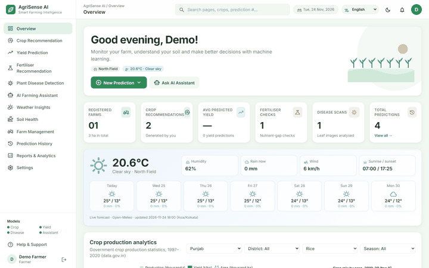
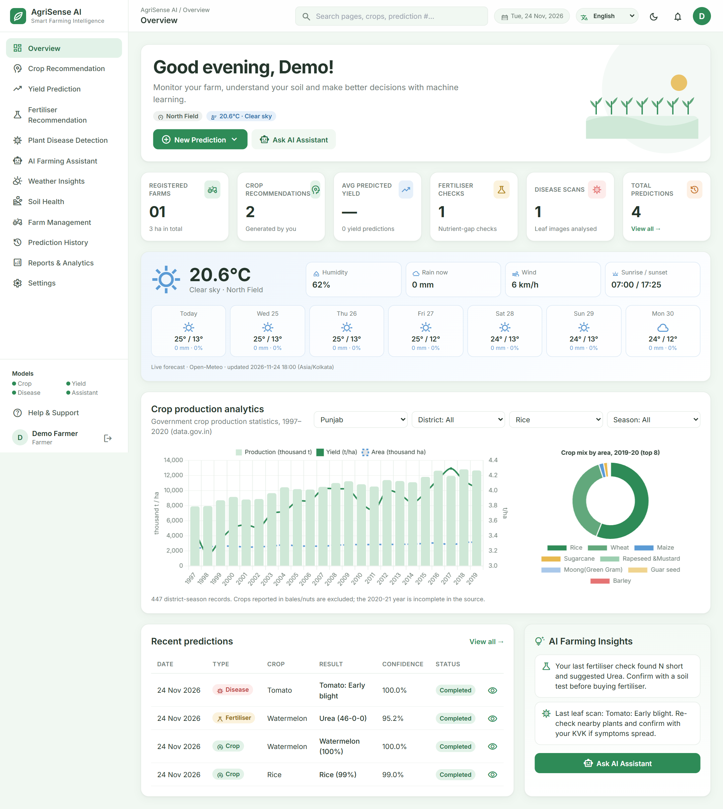
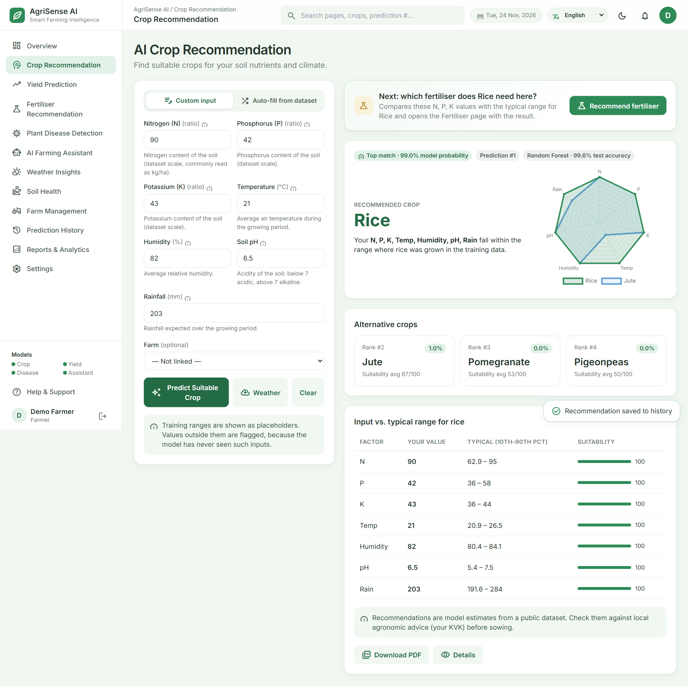
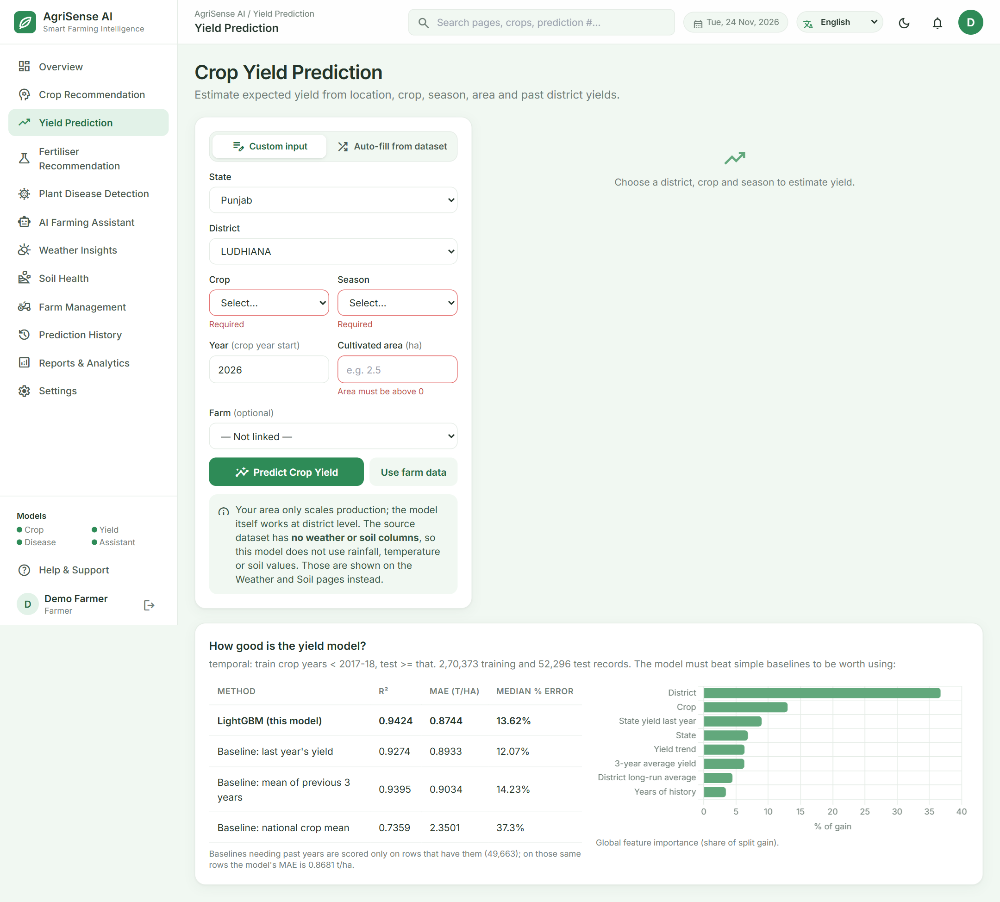
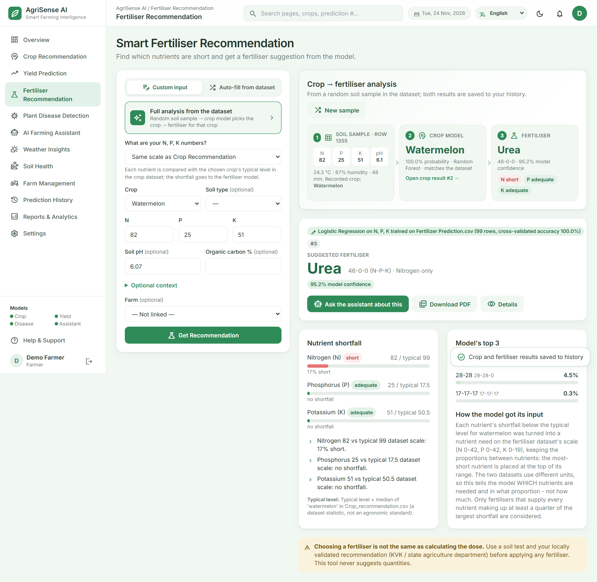
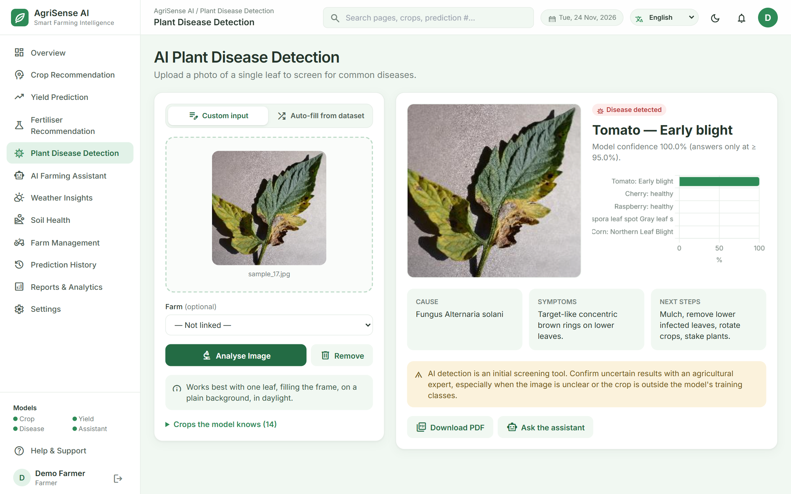
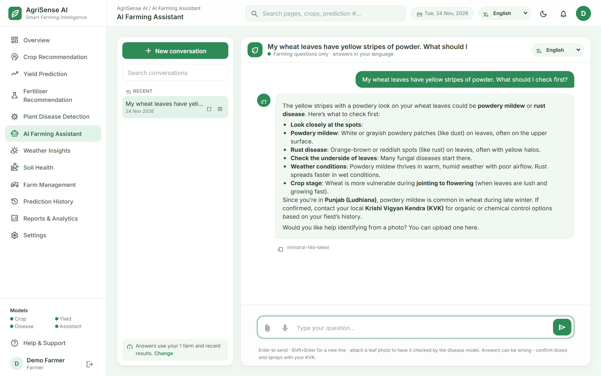
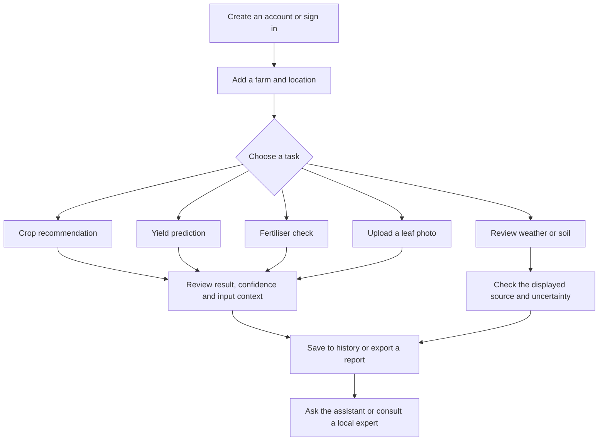
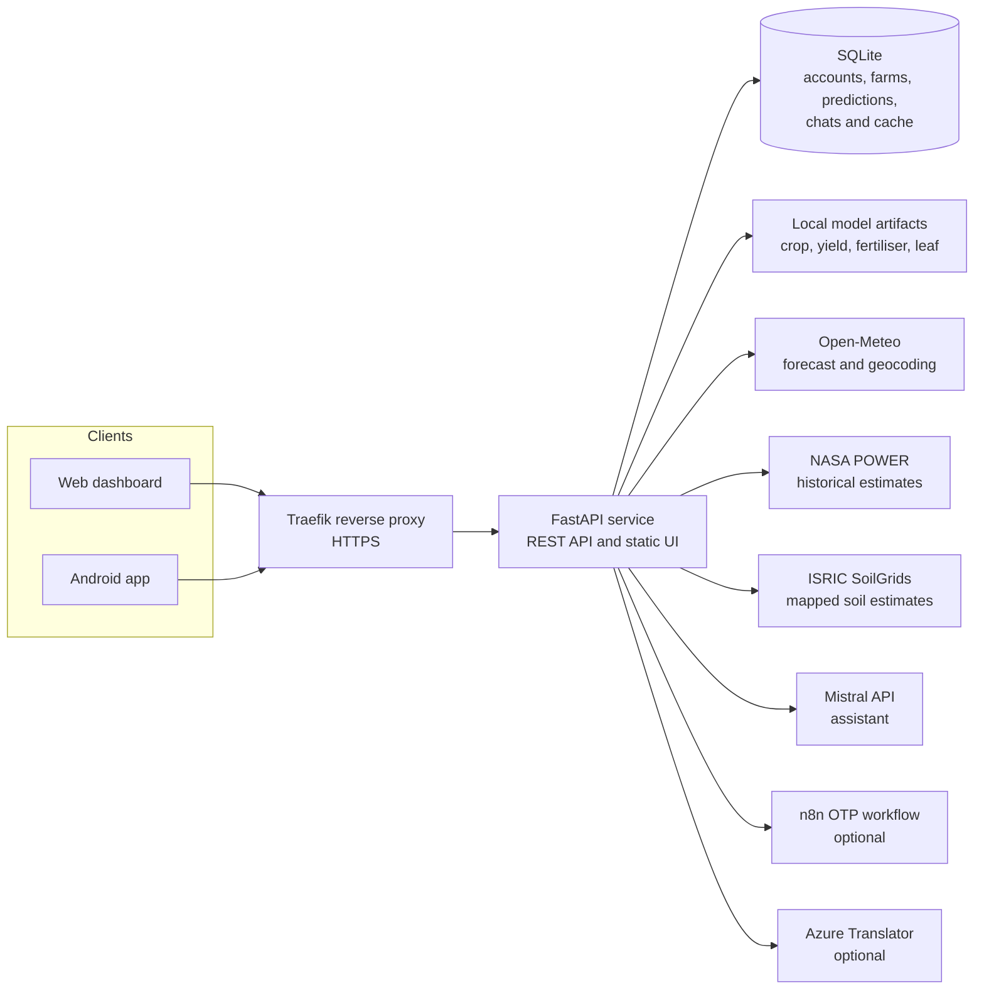

<div align="center">
  
  <br>
  <strong>Smart Farming Intelligence</strong>
  <br><br>
  <a href="https://ai.software.microeagle.online"></a>
  
  
  
  <br><br>
  <em>Practical crop, soil, weather and farm insights — in one web dashboard and Android app.</em>
</div>

<br>

<div align="center">
  
  <br>
  <sub>Product tour assembled from real application screenshots.</sub>
</div>

## Contents

| No. | Section | No. | Section |
|---:|---|---:|---|
| 1 | [Project at a glance](#1-project-at-a-glance) | 8 | [Configuration](#8-configuration) |
| 2 | [Features and model results](#2-features-and-model-results) | 9 | [API reference](#9-api-reference) |
| 3 | [Screenshots](#3-screenshots) | 10 | [Data, privacy and limitations](#10-data-privacy-and-limitations) |
| 4 | [How it works](#4-how-it-works) | 11 | [Tests and model training](#11-tests-and-model-training) |
| 5 | [Architecture](#5-architecture) | 12 | [Deployment](#12-deployment) |
| 6 | [Technology](#6-technology) | 13 | [Repository map and versioning](#13-repository-map-and-versioning) |
| 7 | [Run locally](#7-run-locally) |  |  |

---

## 1. Project at a glance

AgriSense AI is a farming decision-support application built around a FastAPI service, a responsive web dashboard, and a Kotlin/Jetpack Compose Android client. It brings together locally hosted machine-learning models, farm records, live public data services, and an optional AI assistant.

- **Live application:** [ai.software.microeagle.online](https://ai.software.microeagle.online)
- **Interactive API docs:** [/api/docs](https://ai.software.microeagle.online/api/docs)
- **Health check:** [/healthz](https://ai.software.microeagle.online/healthz)
- **Supported clients:** modern web browser and Android (API level 26+)
- **Primary audience:** farmers and agricultural learners looking for explainable, location-aware planning tools

The application is designed to show where information comes from. A model estimate, a public-data reading, and a user's own record are not presented as interchangeable facts.

## 2. Features and model results

| Capability | What it does | Evaluation / data notes |
|---|---|---|
| **Crop recommendation** | Ranks a crop using N, P, K, temperature, humidity, pH and rainfall. | Random Forest; **99.55% held-out accuracy** on the 2,200-row, 22-crop dataset. |
| **Yield prediction** | Estimates yield from crop, season, location, area and historical production. Shows uncertainty and explains input limitations. | LightGBM; **MAE 0.8744 t/ha, R² 0.9424** on a temporal test split of Indian production records. Weather and soil are **not** model inputs. |
| **Fertiliser recommendation** | Suggests a fertiliser type from nutrient shortfall reasoning and N/P/K. | Logistic Regression; **100% reported CV/holdout accuracy** on a 99-row, seven-label dataset. The small dataset makes this estimate uncertain; it does not prescribe a dose. |
| **Leaf disease screening** | Screens a leaf image across 39 PlantVillage-derived classes and can abstain when confidence is low. | EfficientNet-B0; **99.77% test accuracy** on the image evaluation split, with a 95% answer threshold. This is not a field-accuracy claim. |
| **Weather** | Shows a live forecast and historical daily weather estimates. | Open-Meteo forecast/geocoding; NASA POWER gridded historical data. |
| **Soil insights** | Displays mapped soil properties at several depths with uncertainty ranges. | ISRIC SoilGrids 2.0 estimates; these are not laboratory measurements. |
| **Farming assistant** | Answers farming questions using relevant farm and prediction context. | Mistral API; optional configuration, multilingual responses, and a guard against fertiliser/pesticide dose recommendations. |
| **Farm workspace** | Saves farms, prediction history, chat history and downloadable PDF/CSV reports. | Per-install SQLite storage; farm-linked results and activity. |
| **Language support** | Translates the interface and supports multilingual assistant conversations. | Optional Azure Translator configuration. |

**Model scores are dataset-specific.** The crop and disease figures are held-out test results; the deployed fits are subsequently trained on all available training rows. Real-world results can differ, especially for field images, regional datasets, and small training sets. See [limitations](#10-data-privacy-and-limitations) before using predictions to make decisions.

## 3. Screenshots

Screenshots are stored in [`docs/screens/`](docs/screens/). Select an image to open its full-size version.

| Overview | Crop recommendation | Yield prediction |
|---|---|---|
| [](docs/screens/02_overview.png) | [](docs/screens/03_crop.png) | [](docs/screens/04_yield.png) |

| Fertiliser | Leaf disease screening | AI assistant |
|---|---|---|
| [](docs/screens/05_fertiliser.png) | [](docs/screens/06_disease.png) | [](docs/screens/12_assistant.png) |

More screens: [weather](docs/screens/07_weather.png) · [soil](docs/screens/08_soil.png) · [reports](docs/screens/09_reports.png) · [history](docs/screens/10_history.png) · [farms](docs/screens/11_farms.png) · [sign-in](docs/screens/01_login.png).

## 4. How it works

### Typical farmer workflow



### Prediction and data flow

1. The browser or Android client sends a request to the FastAPI API.
2. The API validates the request and, where required, checks the signed-in user's session.
3. Prediction routes load the corresponding local model; weather and soil routes fetch/cache data from their named providers.
4. Results and user-owned records are stored in the application's SQLite database.
5. The client presents the result with relevant confidence, source, or limitation notes.

## 5. Architecture



The repository also includes a source architecture diagram: [`docs/figs/architecture.png`](docs/figs/architecture.png).

## 6. Technology

| Layer | Technologies |
|---|---|
| API and application server | Python 3.12, FastAPI, Uvicorn |
| Machine learning | scikit-learn, LightGBM, ONNX Runtime, Pillow |
| Persistence | SQLite |
| Web client | HTML, CSS, JavaScript |
| Android client | Kotlin, Jetpack Compose, Android Navigation, OkHttp |
| External data | Open-Meteo, NASA POWER, ISRIC SoilGrids |
| Optional services | Mistral API, Azure Translator, n8n OTP workflow |
| Deployment | Docker, Docker Compose, Traefik |
| Tests | pytest; browser tests use Microsoft Edge |

## 7. Run locally

### Prerequisites

- Python **3.12**
- Git
- Optional: Android Studio and an Android SDK for the mobile client

### Start the web app / API

From the repository root in PowerShell:

```powershell
py -3.12 -m venv .venv
.\.venv\Scripts\Activate.ps1
python -m pip install -r requirements.txt
python -m uvicorn app.main:app --host 127.0.0.1 --port 8150
```

Open [http://127.0.0.1:8150](http://127.0.0.1:8150). Interactive API documentation is at [http://127.0.0.1:8150/api/docs](http://127.0.0.1:8150/api/docs).

The web dashboard and bundled model artifacts are part of the repository. Some features require optional API credentials or an internet connection; see [configuration](#8-configuration).

### Build the Android app

The Android client uses the same API. For an Android emulator with the local API running on the host machine:

```powershell
cd android
.\gradlew.bat assembleDebug -Pagrisense.apiBase=http://10.0.2.2:8150
```

`10.0.2.2` is the Android emulator's route to the host computer. For a physical device, use an API address reachable from that device. The default API base is the hosted application; override it with the Gradle property shown above.

## 8. Configuration

The application can load optional settings from the ignored local file `config/api_keys.env`. Create it locally as needed; **never commit API keys, shared secrets, or production credentials**.

| Variable | Required for | Notes |
|---|---|---|
| `MISTRAL_API_KEY` | AI farming assistant | Without it, assistant requests are unavailable. |
| `MISTRAL_MODEL` | Optional assistant model selection | Defaults to `ministral-14b-latest`. |
| `MISTRAL_FALLBACK_MODEL` | Optional assistant fallback | Defaults to `ministral-8b-latest`. |
| `AZURE_TRANSLATOR_KEY` | Optional translation | `AZURE_TRANSLATOR_REGION` and `AZURE_TRANSLATOR_ENDPOINT` can also be supplied. |
| `OTP_WEBHOOK_URL` | Email one-time-code authentication | Enable together with `OTP_SHARED_SECRET`; delivered through the configured n8n workflow. |
| `OTP_SHARED_SECRET` | Email one-time-code authentication | Must match the secret configured in the OTP workflow. |
| `AGRISENSE_STORAGE` | Optional storage location | Defaults to `app/storage`; SQLite is created there. |
| `AGRISENSE_SECURE_COOKIE` | Secure-cookie behavior | Set to `1` when serving behind HTTPS in production. |

When OTP settings are absent, sign-in falls back to password-only mode for local development. Do not use that mode as a production authentication configuration.

## 9. API reference

FastAPI generates the complete interactive schema from the running application:

- Swagger UI: [`/api/docs`](https://ai.software.microeagle.online/api/docs)
- OpenAPI JSON: [`/api/openapi.json`](https://ai.software.microeagle.online/api/openapi.json)
- Liveness check: [`/healthz`](https://ai.software.microeagle.online/healthz)

Common API route groups include:

| Route | Purpose |
|---|---|
| `/api/auth/*`, `/api/me` | Registration, sign-in, OTP verification, and account settings |
| `/api/farms/*` | Create, view, update and remove farms |
| `/api/crop/recommend`, `/api/yield/predict`, `/api/fertiliser` | Generate agricultural recommendations |
| `/api/disease` | Screen an uploaded leaf image |
| `/api/weather*`, `/api/soil` | Location-based external data |
| `/api/predictions*`, `/api/chats*` | User history and assistant conversations |
| `/api/reports/csv`, `/api/reports/pdf` | Export reports |
| `/api/status`, `/api/models/{name}` | Service and model status |

Some endpoints require an authenticated session. Refer to the live OpenAPI schema for request and response models, parameters, and authentication details.

## 10. Data, privacy and limitations

- **Leaf disease is a screening aid, not a diagnosis.** The evaluation uses PlantVillage-derived images, largely clean single leaves on plain backgrounds. Accuracy on complex field photographs has not been measured. Low-confidence results may be withheld.
- **Yield estimates do not use weather or soil.** The trained yield data contains production history and location/crop context, not those external variables.
- **Fertiliser evaluation is based on a very small dataset.** The model names a product only; it does not calculate an application amount. Confirm nutrient needs with a soil test and a qualified local advisor.
- **SoilGrids values are mapped estimates.** They include model uncertainty and are not a substitute for a laboratory test.
- **NASA POWER values are gridded historical estimates.** Open-Meteo forecasts are live external data and may be unavailable.
- **The assistant can be wrong.** It is constrained not to provide fertiliser or pesticide doses; verify agronomic decisions with a local expert or Krishi Vigyan Kendra (KVK).
- **User data is stored in SQLite.** Local development data is under `app/storage` by default; production uses the Docker volume configured in `docker-compose.yml`. Uploaded leaf images are stored with application data.
- **Credentials are excluded from Git.** Keep `config/api_keys.env` and any deployment secrets outside commits; the repository `.gitignore` already excludes local `.env` files.

Use the application as decision support, not as a replacement for soil testing, local agricultural guidance, or professional diagnosis.

## 11. Tests and model training

### Tests

Install the requirements as described above, then run:

```powershell
python -m pytest -q
```

Tests marked `live` call real external services; tests marked `ui` drive the browser and require the expected browser environment. To run only tests that do not carry either marker:

```powershell
python -m pytest -q -m "not live and not ui"
```

### Retraining

Training scripts and evaluation outputs are in [`ml/`](ml/) and [`app/models/`](app/models/).

```powershell
python ml/train_crop.py
python ml/train_yield.py
python ml/train_fertiliser.py
python ml/train_leaf.py
```

The full leaf-model training workflow is separate and resource-intensive:

```powershell
python ml/train_leaf_full.py --epochs 8
```

It uses CUDA when available and writes its staged artifacts under `ml/staging/`. Raw training data is not included in the repository. Read each script and its dataset/license requirements before training or redistributing resulting artifacts.

To regenerate the model report, use `python docs/build_report.py`.

## 12. Deployment

The project includes a Dockerfile, Compose configuration, and a Traefik route in [`deploy/agrisense.yml`](deploy/agrisense.yml). Production deployment expects:

- Docker and Docker Compose on the host.
- A locally available `config/api_keys.env` mounted read-only into the container.
- The external Docker network named in `docker-compose.yml` for n8n-based OTP delivery.
- A reverse proxy / TLS configuration for public HTTPS access.

From the project directory on a configured host:

```sh
docker compose up -d --build
docker compose logs -f agrisense
```

Compose binds the API to `127.0.0.1:8150`; route public traffic through the reverse proxy rather than exposing the container port directly. Persistent application records are held in the named `agrisense_data` volume. Adapt host paths, proxy routing and secret management to your environment before deploying.

## 13. Repository map and versioning

### Project layout

| Path | Contents |
|---|---|
| [`app/`](app/) | FastAPI routes, database helpers, integrations, static dashboard, deployed models |
| [`app/models/`](app/models/) | Model artifacts and JSON evaluation metadata |
| [`android/`](android/) | Kotlin / Jetpack Compose Android client |
| [`ml/`](ml/) | Training and evaluation scripts |
| [`docs/screens/`](docs/screens/) | Product screenshots |
| [`docs/figs/`](docs/figs/) | Architecture, evaluation and load-test figures |
| [`docs/assets/`](docs/assets/) | README logo and animated product tour |
| [`tests/`](tests/) | Automated tests and load-test utilities |
| [`config/`](config/) | Local API-key configuration; secrets are ignored by Git |
| [`deploy/`](deploy/) | Reverse-proxy deployment configuration |
| [`CHANGELOG.md`](CHANGELOG.md) | Release history and unreleased changes |

### Version control

AgriSense AI follows [Semantic Versioning](https://semver.org/). The [changelog](CHANGELOG.md) records notable changes, and Git tags identify published versions. The project is released under the [MIT License](LICENSE). For contributions, work on a focused branch, keep secrets and generated local data out of commits, run the relevant tests, and update the changelog when a change is release-worthy.

---

<div align="center">
  <strong>Built to make agricultural information easier to understand and act on.</strong>
  <br>
  <sub>Always verify recommendations with local conditions and qualified agricultural guidance.</sub>
</div>
